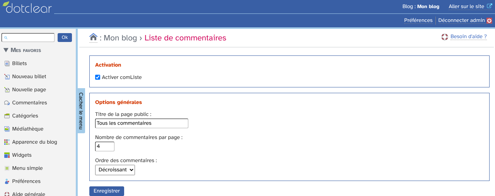
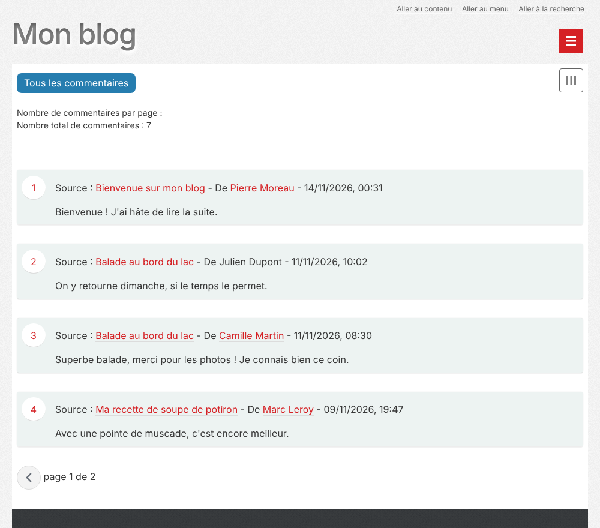
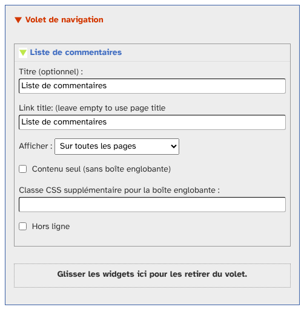
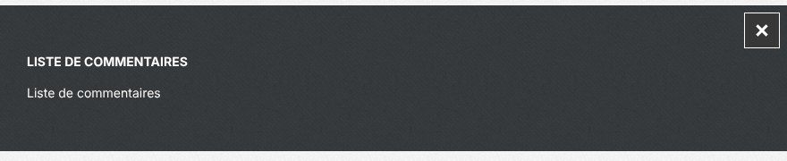
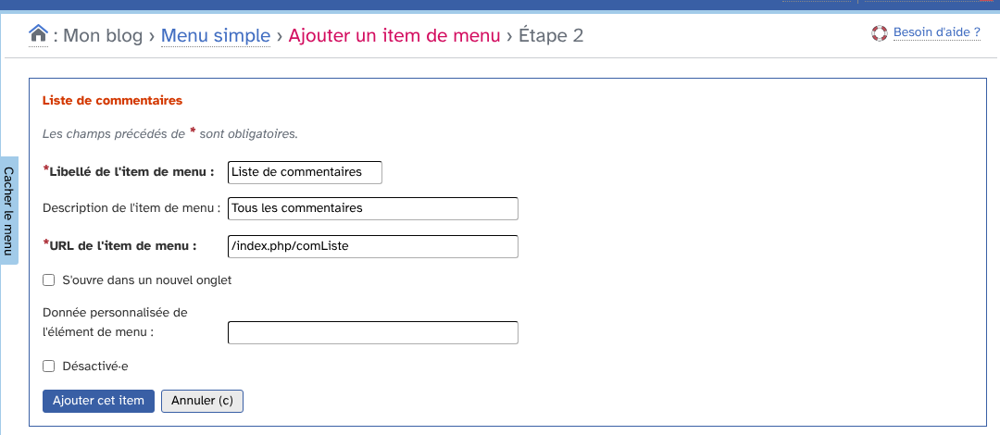

# comListe : guide d'utilisation

comListe ajoute à votre blog une page publique qui liste les commentaires de tous vos billets.
Les visiteurs y voient les derniers commentaires d'un coup d'œil et peuvent aller directement au billet concerné.

## Sommaire

* [Activer la page publique](#activer-la-page-publique)
* [Régler la page](#régler-la-page)
* [La page publique](#la-page-publique)
* [Ajouter un lien avec le widget](#ajouter-un-lien-avec-le-widget)
* [Ajouter un lien dans le menu simple](#ajouter-un-lien-dans-le-menu-simple)
* [Adapter l'apparence](#adapter-lapparence)

## Activer la page publique

Ouvrez le menu « Blog », puis « Liste de commentaires ».
Cochez « Activer comListe », puis enregistrez.

Tant que la case est décochée, la page n'existe pas sur le blog.

## Régler la page

Les réglages se trouvent sur la même page, dans le bloc « Options générales ».

* **Titre de la page public** : le titre affiché en haut de la page ;
* **Nombre de commentaires par page** : combien de commentaires apparaissent avant de passer à la page suivante ;
* **Ordre des commentaires** : « Décroissant » montre les plus récents d'abord, « Croissant » les plus anciens d'abord.

Cliquez sur « Enregistrer » pour appliquer les changements.

## La page publique

La page se trouve à l'adresse `comListe` de votre blog, par exemple `https://monblog.example/index.php/comListe` selon le réglage des adresses de votre blog.

Chaque commentaire indique :

* son numéro dans la liste ;
* le billet concerné, avec un lien ;
* l'auteur et la date ;
* le texte du commentaire.

En bas, les liens de pagination permettent de passer d'une page à l'autre.
Avec les modèles fournis, seuls les commentaires sont listés.

## Ajouter un lien avec le widget

Pour que vos visiteurs trouvent la page, ajoutez le widget « Liste de commentaires ».

1. Ouvrez le menu « Widgets ».
2. Glissez « Liste de commentaires » dans le volet de votre choix.
3. Réglez le widget, puis enregistrez.

Le widget a ces réglages :

* **Titre** : le titre du bloc, facultatif ;
* **Link title** : le texte du lien. Laissé vide, il reprend le titre de la page ;
* **Afficher** : sur toutes les pages ou seulement sur la page d'accueil ;
* **Contenu seul**, **Classe CSS** et **Hors ligne** : les réglages habituels des widgets.

Le widget n'apparaît que si la page publique est activée.

## Ajouter un lien dans le menu simple

Vous pouvez aussi utiliser le plugin Menu simple.

1. Ouvrez « Menu simple », puis « Ajouter un item de menu ».
2. Choisissez le type « Liste de commentaires ».
3. Cliquez sur « Continuer… » : le libellé et l'adresse sont déjà remplis.
4. Cliquez sur « Ajouter cet item ».

## Adapter l'apparence

comListe fournit des modèles prêts à l'emploi pour les thèmes Dotty et Mustek.
Pour un autre thème, copiez le fichier `comListe.html` du dossier `default-templates` du plugin dans le dossier `tpl` de votre thème, puis adaptez-le.
